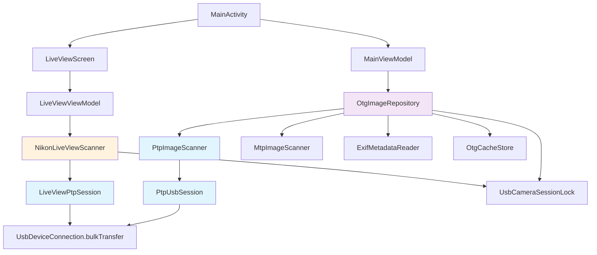
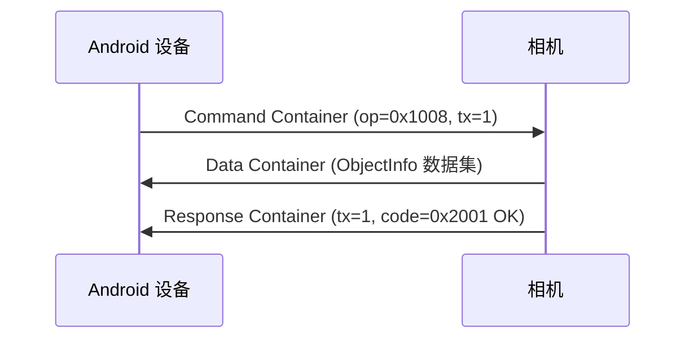
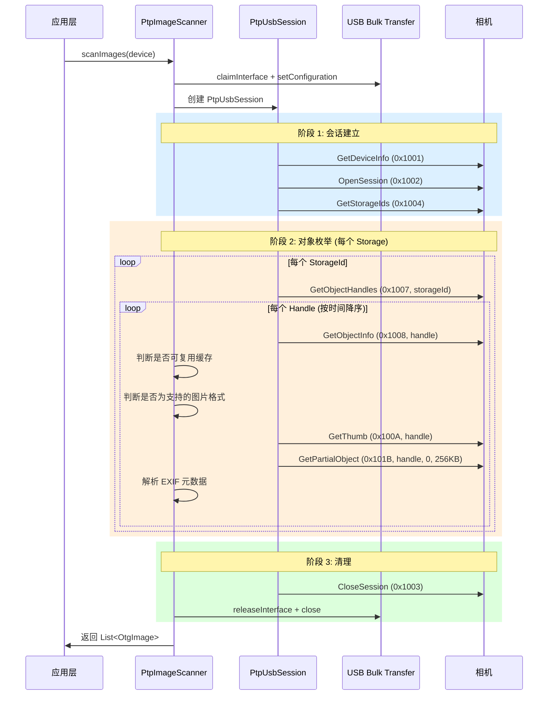
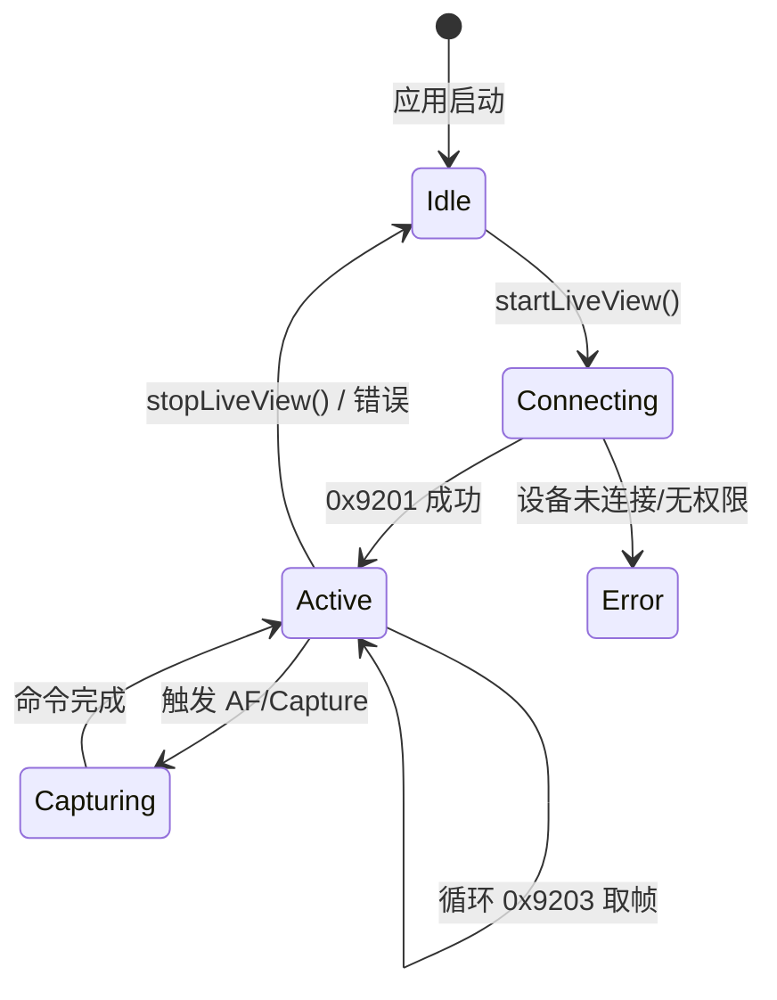

# PTP（Picture Transfer Protocol）协议实现原理报告

> **项目名称**: OTG_Picture_Reader  
> **报告日期**: 2026-05-16  
> **适用范围**: Android OTG 相机图片读取 & Nikon Live View 实时取景

---

## 目录

1. [PTP 协议概述](#1-ptp-协议概述)
2. [项目架构总览](#2-项目架构总览)
3. [核心类与职责](#3-核心类与职责)
4. [PTP 容器格式（Container Format）](#4-ptp-容器格式)
5. [底层 USB 传输实现](#5-底层-usb-传输实现)
6. [标准 PTP 图片扫描流程](#6-标准-ptp-图片扫描流程)
7. [Nikon Live View 实时取景实现](#7-nikon-live-view-实时取景实现)
8. [Exif 元数据读取策略](#8-exif-元数据读取策略)
9. [双模式容错机制（PTP + MTP 回退）](#9-双模式容错机制ptp--mtp-回退)
10. [图片去重与缓存复用](#10-图片去重与缓存复用)
11. [任务取消与生命周期管理](#11-任务取消与生命周期管理)
12. [附录：完整操作码与响应码定义](#12-附录完整操作码与响应码定义)

---

## 1. PTP 协议概述

### 1.1 什么是 PTP

**PTP（Picture Transfer Protocol）** 是 ISO 15740 标准定义的图片传输协议，用于相机与计算机（或移动设备）之间通过 USB 传输图片。PTP 是 MTP（Media Transfer Protocol）的前身和基础，两者的设备发现和基本命令结构一致。

### 1.2 本项目的协议层次

本项目实现了 **三层 PTP 通信栈**：

```
┌──────────────────────────────────────────────┐
│         应用层（ViewModel / Scanner）          │
│  LiveViewViewModel / MainViewModel            │
├──────────────────────────────────────────────┤
│         会话层（PtpUsbSession /                │
│         LiveViewPtpSession）                   │
│  命令构造、响应解析、事务管理                    │
├──────────────────────────────────────────────┤
│         传输层（USB Bulk Transfer）            │
│  UsbDeviceConnection.bulkTransfer()           │
├──────────────────────────────────────────────┤
│         物理层（USB OTG Cable）                 │
│  Android UsbManager / UsbDevice               │
└──────────────────────────────────────────────┘
```

### 1.3 设计决策：为何自行实现 PTP

Android 系统提供了 `android.mtp.MtpDevice` API，但本项目选择**自行实现原始 PTP 协议**，原因如下：

| 维度 | 系统 MtpDevice API | 本项目自定义 PTP |
|------|-------------------|-----------------|
| **命令粒度** | 高层封装，无法发送 Nikon 扩展命令 | 完全可控，支持 Vendor-Extended 操作码 |
| **Live View** | 不支持 | 支持 Nikon 0x9201/0x9203 实时取景 |
| **传输控制** | 黑盒，无法中断单个传输 | 精确控制每笔 bulk transfer 的超时和取消 |
| **错误恢复** | 有限 | 完整的重试、回退、Session 清理机制 |
| **EXIF 读取** | 需下载完整文件 | 通过 GetPartialObject 只读取文件头 256KB |

---

## 2. 项目架构总览

### 2.1 文件结构

```
app/src/main/java/com/example/otg_picture_reader/
├── data/
│   ├── usb/
│   │   ├── PtpImageScanner.kt        ← 自定义 PTP 图片扫描器（核心）
│   │   ├── MtpImageScanner.kt        ← Android MTP API 封装（回退方案）
│   │   ├── UsbScanProgress.kt        ← 扫描进度数据类
│   │   ├── CameraImageIdentity.kt    ← 相机图片唯一标识生成
│   │   └── UsbCameraSessionLock.kt   ← USB 会话互斥锁（Mutex）
│   ├── model/
│   │   ├── OtgImage.kt               ← 图片数据模型
│   │   ├── ImageExifInfo.kt          ← EXIF 信息模型
│   │   └── ScanState.kt             ← 扫描状态模型
│   ├── local/
│   │   ├── OtgImageRepository.kt     ← 图片仓库（扫描调度层）
│   │   ├── OtgCacheStore.kt          ← 缓存持久化
│   │   └── ExifMetadataReader.kt     ← EXIF 元数据解析
│   └── AppContainer.kt              ← 依赖注入容器
├── feature/
│   └── liveview/
│       ├── LiveViewScreen.kt         ← Live View UI（Jetpack Compose）
│       ├── LiveViewViewModel.kt      ← Live View 业务逻辑
│       ├── NikonLiveViewScanner.kt   ← Nikon Live View PTP 扫描器（核心）
│       └── LiveViewState.kt          ← Live View 状态模型
└── MainActivity.kt / MainViewModel.kt ← 主界面 & 主 ViewModel
```

### 2.2 组件依赖关系



---

## 3. 核心类与职责

### 3.1 PtpImageScanner — 标准 PTP 图片扫描器

**职责**: 通过原始 PTP 协议枚举相机上的所有图片对象，提取缩略图和 EXIF 元数据。

**关键方法**:

| 方法 | 功能 |
|------|------|
| `scanImages(device, ...)` | 入口方法，执行完整扫描流程 |
| `findPtpInterface(device)` | 查找 USB_CLASS_STILL_IMAGE 接口 |
| `findEndpoints(usbInterface)` | 定位 Bulk IN / Bulk OUT 端点 |

**内部类 `PtpUsbSession`**: PTP 会话管理，负责命令/响应的编码解码和 USB 传输。

### 3.2 NikonLiveViewScanner — Nikon Live View 扫描器

**职责**: 通过 Nikon 厂商扩展 PTP 命令实现实时取景画面流。

**关键方法**:

| 方法 | PTP 操作码 | 功能 |
|------|-----------|------|
| `startLiveView()` | `0x9201` | 启动实时取景 |
| `getLiveViewImage()` | `0x9203` | 获取一帧 JPEG 取景画面 |
| `autofocus()` | `0x90C1` | 触发自动对焦 |
| `captureToMedia()` | `0x9207` | 触发相机拍摄到存储卡 |

**内部类 `LiveViewPtpSession`**: Nikon Live View 专用 PTP 会话。

### 3.3 OtgImageRepository — 扫描调度中心

**职责**: 统一调度 OTG 文件系统扫描和 PTP/MTP 相机扫描，管理双模式容错策略。

**扫描优先级**:
```
1. 自定义 PTP（PtpImageScanner）→ 支持 EXIF 局部读取，性能最优
2. Android MTP API（MtpImageScanner）→ 兼容性回退
```

### 3.4 UsbCameraSessionLock

全局互斥锁（`kotlinx.coroutines.sync.Mutex`），确保同一时间只有一个协程持有 USB 相机会话，避免并发冲突。

---

## 4. PTP 容器格式（Container Format）

### 4.1 容器头结构

PTP 协议中所有通信都封装为**容器（Container）**，每个容器由 12 字节固定头部 + 可变长度负载组成。

```
偏移  | 大小 | 字段              | 字节序
-----|------|-------------------|--------
 0   | 4    | ContainerLength   | LE U32 — 整个容器的总长度（含头部）
 4   | 2    | ContainerType     | LE U16 — 容器类型
 6   | 2    | Code              | LE U16 — 操作码或响应码
 8   | 4    | TransactionID     | LE U32 — 事务 ID（命令/响应配对用）
12   | N    | Payload           | 负载数据
```

### 4.2 容器类型

| 常量值 | 名称 | 用途 |
|--------|------|------|
| `1` | `TYPE_COMMAND` | 命令容器：请求设备执行操作 |
| `2` | `TYPE_DATA` | 数据容器：随命令发送/接收的数据 |
| `3` | `TYPE_RESPONSE` | 响应容器：设备对命令的应答 |
| `4` | `TYPE_EVENT` | 事件容器：设备主动推送的事件 |

### 4.3 事务模式

PTP 事务遵循**命令 → 数据 → 响应**（CMD → DATA → RSP）的三段式模式：



部分命令（如 OpenSession）只有 CMD → RSP，无 DATA 阶段。

### 4.4 代码实现

`PtpUsbSession.transact()` 方法完整实现了三段式事务：

```kotlin
private fun transact(operationCode: Int, vararg params: Int, transactionId: Int? = null): PtpTransactionResult {
    // 1. 写入命令容器
    writeCommand(operationCode, currentTransactionId, params)
    
    // 2. 读取第一个容器
    val first = readContainer("first")
    
    // 3. 如果第一个容器是 DATA 类型，继续读取 RESPONSE
    val data: ByteArray
    val response: PtpContainer
    if (first.type == PtpContainer.TYPE_DATA) {
        data = first.payload
        response = readContainer("response")  // 读取响应容器
    } else {
        data = ByteArray(0)
        response = first
    }
    
    return PtpTransactionResult(response.code, data)
}
```

**命令写入**（`writeCommand`）细节：

```kotlin
private fun writeCommand(operationCode: Int, transactionId: Int, params: IntArray) {
    // 使用 ByteBuffer 按 Little-Endian 编码
    val buffer = ByteBuffer.allocate(PTP_HEADER_SIZE + params.size * 4)
        .order(ByteOrder.LITTLE_ENDIAN)
    buffer.putInt(length)           // ContainerLength
    buffer.putShort(TYPE_COMMAND)   // ContainerType
    buffer.putShort(operationCode)  // Code (操作码)
    buffer.putInt(transactionId)    // TransactionID
    params.forEach { buffer.putInt(it) }  // 参数列表（每个 4 字节）
    
    // 通过 USB Bulk OUT 端点发送，最多重试 3 次
    connection.bulkTransfer(bulkOut, bytes, bytes.size, USB_TIMEOUT_MS)
}
```

---

## 5. 底层 USB 传输实现

### 5.1 USB 端点发现与配置

PTP 设备使用 `USB_CLASS_STILL_IMAGE`（值为 6）接口类。每个接口包含两个必需的 Bulk 端点和一个可选 Interrupt 端点：

```kotlin
private fun findEndpoints(usbInterface: UsbInterface): PtpEndpoints {
    // Bulk IN  — 从相机读取数据（响应、ObjectInfo、图像数据）
    // Bulk OUT — 向相机发送命令
    // Interrupt IN — 事件通知（可选，部分相机不支持）
}
```

### 5.2 接口声明与配置

```kotlin
// 1. 设置 USB 配置（选择 configuration 0）
connection.setConfiguration(device.getConfiguration(0))

// 2. 声明接口独占权（force=true 强制断开内核驱动）
connection.claimInterface(usbInterface, true)

// 3. 设置活动接口
connection.setInterface(usbInterface)
```

### 5.3 Live View 的额外初始化

NikonLiveViewScanner 在初始化时还会执行**端点 Stall 清除**：

```kotlin
// 清除 Bulk IN 端点的 HALT 状态
connection.controlTransfer(
    USB_RT_CLEAR_FEATURE,        // 0x02: OUT | STANDARD | ENDPOINT
    USB_REQ_CLEAR_FEATURE,       // 0x01: CLEAR_FEATURE
    USB_FEATURE_ENDPOINT_HALT,   // 0x00: ENDPOINT_HALT
    endpoints.bulkIn.address,
    null, 0, USB_CTRL_TIMEOUT_MS
)
```

这是因为相机在上一次异常断开后可能残留 STALL 状态，导致后续 bulkTransfer 返回 -1。

### 5.3 精确读取实现

`readExact(length, label)` 方法实现**按需读取指定字节数**，并带有**剩余数据缓冲**：

```kotlin
private fun readExact(length: Int, label: String): ByteArray {
    val output = ByteArrayOutputStream(length)
    while (output.size() < length) {
        // 1. 优先从上次读取的剩余缓冲中取数据
        val buffered = readFromBuffer(length - output.size())
        if (buffered.isNotEmpty()) { output.write(buffered); continue }
        
        // 2. 从 USB Bulk IN 读取新数据
        val requestSize = minOf(READ_CHUNK_SIZE, length - output.size())
        val read = connection.bulkTransfer(bulkIn, buffer, requestSize, USB_TIMEOUT_MS)
        
        // 3. 消费需要的数据，多余部分存入 readBuffer
        output.write(buffer, 0, consumed)
        if (read > consumed) { readBuffer.write(buffer, consumed, read - consumed) }
    }
    return output.toByteArray()
}
```

这种设计解决了 USB bulk transfer 可能返回比请求**更多或更少**数据的问题——多余数据被暂存，供下一次读取使用。

---

## 6. 标准 PTP 图片扫描流程

### 6.1 完整流程时序图



### 6.2 各步骤详解

#### Step 1: GetDeviceInfo（操作码 0x1001）

- 用途：确认设备存在且 PTP 协议版本兼容
- 事务 ID 固定为 0（标准规定）
- 返回的设备信息数据集包含协议版本、厂商扩展信息等

#### Step 2: OpenSession（操作码 0x1002）

- 参数：`sessionId = 1`
- 用途：建立 PTP 会话，后续所有操作在会话上下文中执行
- 事务 ID 固定为 0

#### Step 3: GetStorageIds（操作码 0x1004）

- 返回：U32 数组，第一个元素为数量，后续为存储介质 ID
- 典型返回值：`[1, 0x00010001]`（1 个存储，SD 卡）

#### Step 4: GetObjectHandles（操作码 0x1007）

- 参数：`(storageId, 0x00000000, 0xFFFFFFFF)`
- 第二个参数为 ObjectFormatCode（0 = 不限格式）
- 第三个参数为 ParentHandle（0xFFFFFFFF = 所有对象）
- 返回：U32 数组，第一个元素为数量，后续为对象句柄列表

#### Step 5: GetObjectInfo（操作码 0x1008）

- 参数：`handle`
- 返回：ObjectInfo 数据集（包含格式、尺寸、文件名、拍摄时间等）

解析 ObjectInfo 数据集的关键字段：

```kotlin
data class PtpObjectInfo(
    val format: Int,        // 0x3801=EXIF_JPEG, 0x380B=PNG
    val size: Long,         // 文件大小（字节）
    val thumbSize: Long,    // 缩略图大小
    val width: Int,         // 图片宽度
    val height: Int,        // 图片高度
    val fileName: String,   // 文件名（UTF-16LE 编码）
    val captureTime: Long?, // 拍摄时间（解析自 "yyyyMMdd'T'HHmmss" 格式）
    val modifiedTime: Long? // 修改时间
)
```

#### Step 6: GetThumb（操作码 0x100A）

- 参数：`handle`
- 返回：JPEG 缩略图字节数据
- 用途：无需下载完整大图即可获得缩略图用于列表展示

#### Step 7: GetPartialObject（操作码 0x101B）— EXIF 读取

- 参数：`(handle, offset=0, maxBytes=256KB)`
- 用途：**仅读取文件头部 256KB**，从中提取 EXIF 元数据
- 优势：避免下载数 MB 的完整图片，极大提升扫描速度

### 6.3 数据解析工具

`PtpDataReader` 类提供了对 PTP 数据集（Dataset）的二进制解析：

```kotlin
private class PtpDataReader(private val bytes: ByteArray) {
    fun u16(): Int    // 读取 2 字节 Little-Endian 无符号整数
    fun u32(): Int    // 读取 4 字节 Little-Endian 无符号整数
    fun string(): String  // 读取 PTP 字符串（1 字节长度 + UTF-16LE 字符）
}
```

PTP 字符串编码格式：`[1 byte: 字符数] [N×2 bytes: UTF-16LE 字符] [2 bytes: null terminator]`

---

## 7. Nikon Live View 实时取景实现

### 7.1 Live View 架构

Nikon Live View 功能通过**厂商扩展（Vendor-Extended）PTP 命令**实现，包含三个核心操作：

| 操作码 | Nikon 命令名 | 功能 |
|--------|-------------|------|
| `0x9201` | StartLiveView | 启动实时取景模式 |
| `0x9203` | GetLiveViewImage | 获取一帧 JPEG 取景画面 |
| `0x9202` | EndLiveView | 结束实时取景模式 |

### 7.2 Live View 生命周期



### 7.3 帧获取主循环

```kotlin
while (!stopRequested.get()) {
    // 1. 处理待执行的命令（AF / Capture）
    handlePendingCommands(session)
    
    // 2. 获取一帧 Live View JPEG
    val jpegData = session.getLiveViewImage()
    
    // 3. 相机未就绪时等待重试
    if (jpegData.isEmpty()) {
        Thread.sleep(LIVEVIEW_RETRY_DELAY_MS)
        continue
    }
    
    // 4. 通过 Channel 发送帧到 ViewModel
    frameChannel.trySend(LiveViewFrame(...))
}
```

Live View 取帧使用独立超时（`LIVEVIEW_USB_TIMEOUT_MS = 1500ms`），因为相机可能正在处理 AF 等操作导致响应延迟。

### 7.4 Nikon 扩展相机命令

| 操作码 | 命令 | 功能 |
|--------|------|------|
| `0x90C1` | AfDrive | 触发自动对焦 |
| `0x90C8` | DeviceReady | 查询设备是否就绪 |
| `0x9207` | InitiateCaptureRecInMedia | 触发拍摄并存储到 SD 卡 |
| `0x1015` | GetDevicePropValue | 读取设备属性（快门/光圈/ISO 等） |

### 7.5 拍摄参数实时读取

在 Live View 启动时读取相机当前参数：

```kotlin
cameraParams = LiveViewParams(
    shutterSpeed      = session.getDevicePropValue(NIKON_PROP_EXPOSURE_TIME)  // 0xD100
    aperture          = session.getDevicePropValue(PTP_PROP_F_NUMBER)         // 0x5007
    iso               = session.getDevicePropValue(PTP_PROP_EXPOSURE_INDEX)   // 0x500F
    exposureCompensation = session.getDevicePropValue(0x5010)                 // 曝光补偿
    shootingMode      = session.getDevicePropValue(0x500E)                    // 拍摄模式
    whiteBalance      = session.getDevicePropValue(0x5005)                    // 白平衡
    batteryLevel      = session.getDevicePropValue(0x5001)                    // 电池电量
    remainingShots    = session.getDevicePropValue(0x5004)                    // 剩余可拍张数
)
```

### 7.6 会话打开的安全处理

相机可能因异常断开而残留已打开的 Session，此时 `OpenSession (0x1002)` 会返回 `0x201E`（SessionAlreadyOpened）。`openSessionSafely` 方法处理此情况：

```kotlin
fun openSessionSafely(sessionId: Int) {
    val result = transact(0x1002, sessionId, transactionId = 0)
    if (result.responseCode == 0x201E) {
        // 先关闭残留会话
        closeSession()
        // 重试打开
        val retryResult = transact(0x1002, sessionId, transactionId = 0)
        checkResponse("OpenSession (retry)", retryResult.responseCode)
    }
}
```

### 7.7 Stop 时的强制连接关闭

Live View 停止时可选择**强制关闭 USB 连接**：

```kotlin
if (forceCloseOnStop) {
    connection.close()  // 直接关闭底层 fd，快速中断阻塞的 bulkTransfer
}
```

此机制用于用户主动停止时的快速响应，避免等待当前 bulkTransfer 超时（最长 10 秒）。

---

## 8. Exif 元数据读取策略

### 8.1 双重读取路径

```
            ┌──────────────────────┐
            │   需要 EXIF 信息?     │
            └──────────┬───────────┘
                       │
          ┌────────────▼────────────┐
          │  是 JPEG 格式?           │
          └──┬──────────────────┬───┘
             │ 是               │ 否
             ▼                  ▼
   ┌──────────────────┐  ┌──────────────┐
   │ GetPartialObject  │  │ 使用 ObjectInfo│
   │ (0x101B, 256KB)  │  │ 中的信息作为   │
   │ + ExifMetadata   │  │ fallback      │
   │ Reader 解析      │  │              │
   └──────────────────┘  └──────────────┘
```

### 8.2 部分对象读取策略

```kotlin
fun readPartialExif(handle: Int, info: PtpObjectInfo): ImageExifInfo? {
    if (!info.canReadExifHeader()) return null  // 仅 JPEG 支持
    val maxBytes = minOf(PTP_EXIF_HEADER_BYTES.toLong(), info.size).toInt()  // 最多 256KB
    val headerBytes = getPartialObject(handle, 0L, maxBytes)
    return ExifMetadataReader.read(ByteArrayInputStream(headerBytes))
}
```

### 8.3 ExifMetadataReader 解析能力

使用 Android 内置的 `androidx.exifinterface.media.ExifInterface` 解析以下 EXIF 标签：

| EXIF Tag | 解析字段 |
|----------|---------|
| `DateTimeOriginal` / `DateTimeDigitized` | 拍摄时间（含时区） |
| `Make` / `Model` | 相机品牌/型号 |
| `LensModel` / `LensSpecification` | 镜头型号/规格 |
| `FocalLength` / `FocalLengthIn35mmFilm` | 焦距 |
| `FNumber` | 光圈值 |
| `ExposureTime` | 快门速度 |
| `ISOSpeedRatings` | ISO 感光度 |
| `ImageWidth` / `ImageLength` | 图片尺寸 |

### 8.4 Fallback 机制

当 EXIF 读取失败或非 JPEG 格式时，`withObjectInfoFallback` 扩展函数用 PTP ObjectInfo 中的信息补全：

```kotlin
fun ImageExifInfo?.withObjectInfoFallback(info: PtpObjectInfo, fallbackTime: Long): ImageExifInfo {
    return copy(
        takenTime = takenTime ?: info.captureTime ?: fallbackTime,
        width = width ?: info.width.takeIf { it > 0 },
        height = height ?: info.height.takeIf { it > 0 }
    )
}
```

---

## 9. 双模式容错机制（PTP + MTP 回退）

### 9.1 扫描调度策略

`OtgImageRepository.scanMtpImages()` 实现了**乐观快速路径 + 兜底回退**：

```
scanMtpImages()
    │
    ├─ 1. 尝试自定义 PTP (PtpImageScanner) ← 优先，支持 EXIF 局部读取
    │     └─ 成功 → 返回结果
    │     └─ 失败（非 CancellationException）
    │         │
    │         └─ 2. 回退到 Android MTP API (MtpImageScanner)
    │               └─ 成功 → 返回结果
    │               └─ 失败 → 抛出聚合异常
```

### 9.2 两种扫描器的对比

| 特性 | PtpImageScanner（自定义 PTP） | MtpImageScanner（Android MTP API） |
|------|------------------------------|-----------------------------------|
| 实现方式 | 原始 USB Bulk Transfer | `android.mtp.MtpDevice` |
| EXIF 读取 | GetPartialObject 只读头部 256KB | 需要下载完整文件 |
| 缩略图 | GetThumb 直接获取 | 通过 MtpDevice API |
| 目录遍历 | 仅扁平对象枚举 | 支持递归文件夹（FORMAT_ASSOCIATION） |
| 厂商扩展 | 支持 | 不支持 |
| Live View | 支持（Nikon 0x9201） | 不支持 |
| 兼容性 | 需要设备严格遵循 PTP 标准 | 广泛兼容（厂商 MTP 驱动） |
| 超时控制 | PingTimeout | PingTimeout + 两个扫描器共用 |

### 9.3 互斥锁保护

所有相机 USB 扫描操作都在 `UsbCameraSessionLock.mutex` 保护下执行：

```kotlin
UsbCameraSessionLock.mutex.withLock {
    // 先尝试 PTP
    runCatching {
        withTimeout(PTP_SCAN_TIMEOUT_MS) {
            ptpImageScanner.scanImages(device, ...)
        }
    }.recoverCatching { ptpError ->
        // PTP 失败，回退 MTP
        withTimeout(PTP_SCAN_TIMEOUT_MS) {
            mtpImageScanner.scanImages(...)
        }
    }.getOrThrow()
}
```

---

## 10. 图片去重与缓存复用

### 10.1 图片唯一标识（CameraImageIdentity）

```kotlin
fun cameraImageId(displayName, sizeBytes, modifiedTime, width, height): String {
    return "camera_${normalizedName}_${sizeBytes}_${timePart}"
        .replace(Regex("[^a-z0-9._-]+"), "_")
}
```

### 10.2 跨扫描会话复用

`scanImages` 接收 `existingImages` 参数，实现增量扫描时的缓存复用：

```kotlin
// 构建已存在图片的 ID → OtgImage 映射
val reusableImages = buildReusableImageMap(existingImages)

// 遍历对象时优先检查缓存
val reusedImage = reusableImages[imageId]?.takeIf { it.hasUsableCachedContent() }
if (reusedImage != null) {
    images += reusedImage    // 直接复用，跳过缩略图下载
    return@forEachIndexed
}
```

### 10.3 去重 Dedup

```kotlin
private fun dedupeCameraImages(images: List<OtgImage>): List<OtgImage> {
    val result = LinkedHashMap<String, OtgImage>()
    images.sortedByDescending { it.sortTime }.forEach { image ->
        val key = image.cameraDedupeKey()  // "name|size|time"
        // 保留更优版本（有缩略图者优先，camera_ 前缀者优先，时间更新者优先）
        if (existing == null || image.isPreferredOver(existing)) {
            result[key] = image
        }
    }
    return result.values.sortedByDescending { it.sortTime }
}
```

### 10.4 中途停止时的缓存持久化

当用户中途停止扫描时，`persistCurrentScanCache()` 保留已扫描的结果：

```kotlin
stopCameraScanRequested.set(true)
activeJob.cancel(CancellationException("用户停止相机扫描"))
persistCurrentScanCache("已停止扫描，已保存当前 ${_images.value.size} 张缓存图片。")
```

---

## 11. 任务取消与生命周期管理

### 11.1 取消信号传播链

```
用户点击「停止」→ MainViewModel.stopCameraScan()
    → OtgImageRepository.stopCameraScan()
        → AtomicBoolean.stopCameraScanRequested = true
        → Job.cancel(CancellationException)
            → PtpImageScanner.shouldStop() lambda 返回 true
                → throwIfStopped() 抛出 CancellationException
```

### 11.2 检查点分布

```kotlin
private fun throwIfStopped(shouldStop: () -> Boolean) {
    if (shouldStop()) throw CancellationException("用户停止相机扫描")
}
```

检查点分布在以下关键位置：
- 每个 StorageId 循环开始
- 每个 Handle 循环开始
- 每个 USB 命令发送前
- 每次进度回调前

### 11.3 Live View 的双重停止机制

1. **正常停止**: `stopRequested.set(true)` → 主循环退出 → `EndLiveView` → `CloseSession` → `releaseInterface`
2. **强制停止**: `forceCloseOnStop` 时直接 `connection.close()`（关闭底层文件描述符，使正在阻塞的 `bulkTransfer` 立即返回错误）

---

## 12. 附录：完整操作码与响应码定义

### 12.1 标准 PTP 操作码（PtpImageScanner 使用）

| 操作码 | 常量名 | 参数 | 用途 |
|--------|--------|------|------|
| `0x1001` | GET_DEVICE_INFO | 无 | 获取设备信息 |
| `0x1002` | OPEN_SESSION | sessionId | 打开 PTP 会话 |
| `0x1003` | CLOSE_SESSION | 无 | 关闭 PTP 会话 |
| `0x1004` | GET_STORAGE_IDS | 无 | 获取存储介质 ID 列表 |
| `0x1007` | GET_OBJECT_HANDLES | storageId, format, parent | 枚举对象句柄 |
| `0x1008` | GET_OBJECT_INFO | handle | 获取对象元数据 |
| `0x1009` | GET_OBJECT | handle | 获取完整对象数据 |
| `0x100A` | GET_THUMB | handle | 获取缩略图 |
| `0x101B` | GET_PARTIAL_OBJECT | handle, offset, maxBytes | 获取对象部分数据 |

### 12.2 Nikon 扩展操作码（NikonLiveViewScanner 使用）

| 操作码 | 常量名 | 用途 |
|--------|--------|------|
| `0x9201` | StartLiveView | 启动实时取景 |
| `0x9202` | EndLiveView | 结束实时取景 |
| `0x9203` | GetLiveViewImage | 获取取景帧 JPEG |
| `0x9207` | InitiateCaptureRecInMedia | 触发拍摄存储 |
| `0x90C1` | AfDrive | 自动对焦驱动 |
| `0x90C8` | DeviceReady | 查询设备就绪状态 |

### 12.3 标准 PTP 属性码

| 属性码 | 常量名 | 含义 |
|--------|--------|------|
| `0x5001` | BATTERY_LEVEL | 电池电量 |
| `0x5004` | REMAINING_SHOTS | 剩余拍摄张数 |
| `0x5005` | WHITE_BALANCE | 白平衡 |
| `0x5007` | F_NUMBER | 光圈值 |
| `0x500E` | EXPOSURE_PROGRAM_MODE | 曝光模式 |
| `0x500F` | EXPOSURE_INDEX | ISO 感光度 |
| `0x5010` | EXPOSURE_BIAS_COMPENSATION | 曝光补偿 |

### 12.4 Nikon 扩展属性码

| 属性码 | 含义 |
|--------|------|
| `0xD100` | 快门速度（Nikon 专有编码） |

### 12.5 响应码

| 响应码 | 常量名 | 含义 |
|--------|--------|------|
| `0x2001` | OK | 操作成功 |
| `0x2002` | GeneralError | 一般错误 |
| `0x2003` | SessionNotOpen | 会话未打开 |
| `0x2004` | InvalidTransactionID | 无效事务 ID |
| `0x2005` | OperationNotSupported | 不支持的操作 |
| `0x2006` | ParameterNotSupported | 不支持的参数 |
| `0x200A` | DevicePropNotSupported | 不支持的设备属性 |
| `0x2019` | DeviceBusy | 设备忙 |
| `0x201E` | SessionAlreadyOpened | 会话已打开 |
| `0xA00B` | NikonNotLiveView | 未处于 Live View 模式（Nikon） |

### 12.6 传输常量

| 常量 | 值 | 用途 |
|------|-----|------|
| `PTP_HEADER_SIZE` | 12 字节 | 容器头大小 |
| `PTP_READ_CHUNK_SIZE` | 16KB | Bulk IN 单次读取块大小 |
| `PTP_EXIF_HEADER_BYTES` | 256KB | EXIF 读取的最大字节数 |
| `USB_TIMEOUT_MS` | 10,000ms | USB 传输超时 |
| `LIVEVIEW_USB_TIMEOUT_MS` | 1,500ms | Live View 帧获取超时 |
| `PTP_WRITE_RETRY_COUNT` | 3 | 写入重试次数 |
| `PTP_WRITE_RETRY_DELAY_MS` | 120ms | 写入重试间隔 |
| `PTP_PARENT_ALL` | -1 (0xFFFFFFFF) | 枚举所有子对象 |
| `PTP_SCAN_TIMEOUT_MS` | 参考代码 | 整体扫描超时 |


---

## 总结

本项目实现了一套**完整的 Android 端 PTP 协议栈**，具有以下亮点：

1. **纯自研 PTP 实现**：直接通过 Android USB Host API（`UsbDeviceConnection.bulkTransfer`）进行 PTP 容器级通信，不依赖系统 `MtpDevice` 黑盒。

2. **Nikon 厂商扩展支持**：实现了 Nikon Live View 协议（0x9201/0x9203），支持实时取景画面流、自动对焦和遥控拍摄。

3. **高效的 EXIF 读取**：通过 `GetPartialObject` 只读取文件前 256KB，避免下载完整大图。

4. **双模式容错**：PTP 优先、MTP 回退的扫描策略，兼顾性能与兼容性。

5. **跨会话缓存复用**：增量扫描时复用已缓存的缩略图和元数据，减少重复传输。

6. **完善的生命周期管理**：通过 `CancellationException` + `AtomicBoolean` + `Mutex` 实现安全的并发取消。

7. **精确的字节流控制**：自定义 `readExact` + `readBuffer` 缓冲区管理，应对 USB bulk transfer 不精确读取的特性。
