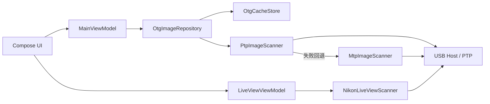

# OTG Picture Reader

通过 USB OTG 在 Android 设备上直接浏览相机照片，并为 Nikon 相机提供实时取景、对焦和快门控制。

应用同时支持两条读取路径：一条面向 U 盘、读卡器等标准 OTG 存储，另一条直接通过 PTP/MTP 协议连接相机，无需手动导出照片。

## 功能特性

- **两种图片来源**
  - 通过系统文件选择器打开 OTG 目录 / U 盘 / 读卡器。
  - 通过 USB OTG 直接连接相机，自动申请访问权限并扫描照片。
- **PTP 优先，MTP 回退**
  - 内置 PTP 协议栈，直接读取相机的对象列表、缩略图和 EXIF 信息。
  - PTP 读取失败时自动回退到 Android `MtpDevice`，提高设备兼容性。
- **增量扫描与本地缓存**
  - 根据文件名、大小和修改时间复用已缓存的图片与缩略图，重复扫描只处理新增内容。
  - 索引和缩略图保存在应用私有目录，重启后可直接恢复。
- **EXIF 信息**
  - 展示相机型号、镜头、焦距、光圈、快门、ISO、拍摄时间等信息。
- **浏览与批量操作**
  - 自适应网格、全屏预览、双指缩放、左右滑动切换。
  - 长按进入多选，支持批量保存和批量分享。
  - 支持按拍摄时间升序或降序排列。
- **保存与分享**
  - 可将图片保存到系统相册，或通过系统分享面板发送到其他应用。
  - OTG 目录和 MTP 模式读取原图；PTP 直连模式以缩略图浏览为主。
- **Nikon 实时取景**
  - 通过 Nikon 厂商扩展 PTP 指令获取实时画面。
  - 实时显示快门、光圈、ISO、曝光补偿、白平衡、电池和剩余张数。
  - 支持自动对焦、拍照和 FPS 指示。
- **Material 3 界面**
  - 支持浅色 / 深色主题，Android 12 及以上使用系统动态取色。

## 环境要求

| 项目 | 要求 |
| --- | --- |
| Android 版本 | Android 7.0（API 24）及以上 |
| 硬件 | 支持 USB Host / OTG 的 Android 设备 |
| 相机设置 | USB 模式设为 PTP（照片传输）或 MTP（文件传输） |
| 构建环境 | Android Studio（支持 AGP 9.2）、JDK 21、Android SDK Platform 36.1 |
| 构建工具 | Gradle 9.4.1（随 Wrapper 提供） |

## 构建与运行

克隆仓库并使用 Gradle Wrapper 构建：

```bash
git clone https://github.com/Phnt0mW/OTG_Picture_Reader.git
cd OTG_Picture_Reader
./gradlew assembleDebug
```

生成的 APK 位于：

```text
app/build/outputs/apk/debug/app-debug.apk
```

也可以直接用 Android Studio 打开项目，等待 Gradle 同步完成后运行 `app` 模块。

> 项目未提交 `local.properties`，Android Studio 会自动生成；命令行构建时请确保已安装 Android SDK，并配置 `ANDROID_HOME` 或 `local.properties` 中的 `sdk.dir`。

## 使用说明

### 连接相机

1. 在相机菜单中把 USB 模式设置为 **PTP** 或 **MTP**。
2. 使用支持数据传输的 OTG 转接线连接相机和手机。
3. 应用会自动申请 USB 访问权限并开始扫描；也可以在右上角「设置」菜单中手动扫描。
4. 首次连接时若未授权，请允许 USB 访问后重试。

扫描过程中会先尝试内置 PTP 实现，失败后自动回退到 MTP。扫描完成后，应用会生成缩略图并缓存索引。

### 浏览 OTG 目录

在右上角「设置」菜单中选择「选择 OTG 目录」，授权后即可扫描 U 盘、读卡器或相机挂载出的存储目录。

### 浏览与管理照片

- 点击图片进入全屏预览，左右滑动切换，双指缩放查看细节。
- 长按图片或点击预览页右上角的「选择」进入多选模式。
- 在预览页底部查看 EXIF 信息，并保存或分享当前图片。
- 多选后可以批量保存、批量分享或清空选择。
- 「设置」菜单中可以切换拍摄时间排序、重新扫描或清除当前来源缓存。

### Nikon 实时取景

1. 连接 Nikon 相机并授予 USB 权限。
2. 在「设置」菜单中选择「实时取景（Live View）」。
3. 点击「开始监视」后即可看到实时画面和拍摄参数。
4. 使用 `AF` 按钮自动对焦，使用圆形快门按钮拍照，点击「停止监视」结束会话。

> 实时取景基于 Nikon 厂商扩展 PTP 指令实现，目前仅支持 Nikon 相机。不同机型的可用功能可能存在差异。

## 工作原理



### PTP 扫描流程

1. 发现 USB 接口和 Bulk IN / Bulk OUT 端点。
2. 打开设备连接并占用 PTP 接口。
3. 依次执行 `GetDeviceInfo`、`OpenSession`、`GetStorageIds`、`GetObjectHandles`。
4. 通过 `GetObjectInfo` 获取文件名、大小和时间。
5. 通过 `GetThumb` 读取缩略图，通过 `GetPartialObject` 读取文件头部的 EXIF 信息。
6. 将图片写入本地索引，并生成统一尺寸的缩略图。

### MTP 回退

当相机不兼容自定义 PTP 流程时，应用改用 Android 原生 `MtpDevice` 遍历存储和对象，把原图缓存到应用私有目录，再复用同一套索引、预览、保存和分享流程。

### 缓存与去重

图片 ID 由文件名、大小和修改时间生成。扫描时会优先复用已有缩略图和原图，避免重复下载；PTP 与 MTP 结果使用同一套去重规则合并。

### 会话互斥

图片扫描和实时取景共用同一条 USB 链路，二者通过 `UsbCameraSessionLock` 互斥，避免同时占用 PTP 接口。扫描进行中无法启动实时取景。

## 项目结构

```text
app/src/main/java/com/example/otg_picture_reader/
├── MainActivity.kt              # Compose 界面与交互
├── MainViewModel.kt             # 图库状态、选择、保存与分享
├── OtgPictureReaderApp.kt       # Application 与依赖容器
├── data/
│   ├── AppContainer.kt          # 手动依赖注入
│   ├── local/
│   │   ├── ExifMetadataReader.kt
│   │   ├── OtgCacheStore.kt     # 索引持久化
│   │   └── OtgImageRepository.kt# 扫描调度、缩略图、保存与分享
│   ├── model/                   # 图片、EXIF、扫描状态模型
│   └── usb/
│       ├── PtpImageScanner.kt   # 标准 PTP 实现
│       ├── MtpImageScanner.kt   # MtpDevice 回退实现
│       └── CameraImageIdentity.kt
├── feature/liveview/            # Nikon 实时取景
├── ui/theme/                    # Material 3 主题
└── util/AppLog.kt               # 可开关的日志与崩溃记录
```

## 相关文档

- [PTP 协议实现原理报告](PTP协议实现原理报告.md)：协议分层、容器格式、USB 传输、扫描流程、Nikon 扩展指令与容错机制的详细说明。

## 常见问题

**找不到相机设备？**

- 确认 OTG 转接线支持数据传输，而不是仅充电线。
- 确认相机 USB 模式为 PTP 或 MTP。
- 部分相机需要先在机身菜单中启用 USB 连接，或在连接后选择「照片传输」。
- 尝试重新插拔，或在系统设置中清除该 USB 设备的默认应用。

**提示没有 USB 访问权限？**

重新插拔设备并在弹窗中允许访问。若之前选择了拒绝，需要在系统设置中清除该 USB 设备的默认选项后重试。

**保存或分享失败，提示 PTP 模式只有缩略图？**

PTP 直连路径只读取缩略图和 EXIF，用于快速浏览。需要原图时可以使用 OTG 目录方式，或让应用回退到 MTP 模式后重新扫描。

**实时取景无法启动？**

- 确认连接的是 Nikon 相机。
- 先停止图片扫描，再打开实时取景。
- 部分机型需要在相机菜单中启用 Live View。
- 退出其他正在占用相机的应用后重试。

**扫描速度较慢？**

首次扫描需要读取缩略图、解析 EXIF 并生成缓存；后续扫描会复用已有缓存，只处理新增图片。扫描过程中可以随时点击「停止扫描」，已索引的内容会保留。

## 参与贡献

欢迎提交 Issue 或 Pull Request。提交前请确保项目可以正常构建，并尽量保持改动聚焦、说明清晰。
